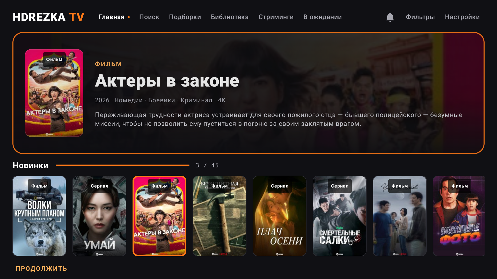
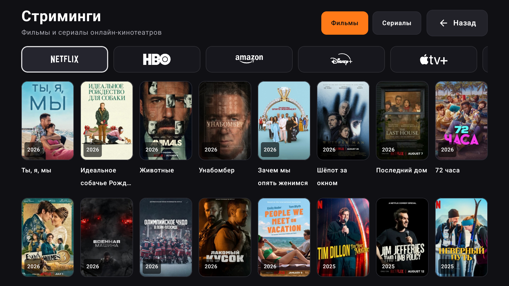
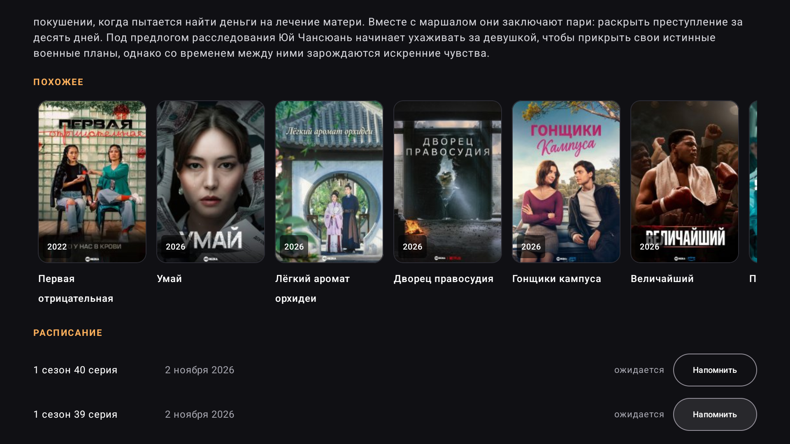

# HDrezka TV

Красивый клиент **HDrezka** для Android TV / Google TV на Kotlin + Jetpack Compose.

Приложение не содержит аккаунтов, токенов и персональных данных. Это чистая
пользовательская сборка: войдите в свой аккаунт HDrezka и пользуйтесь.

[](https://github.com/R3G1ST/HDRezkaTV/releases/latest)
[](https://r3g1st.github.io/HDRezkaTV/)

## Возможности

- Главная с hero-баннером и каруселью «Новинки».
- «Продолжить», «Мой список», «Топ-10», «Рекомендуем».
- Фильмы, сериалы, мультфильмы, аниме и документальные.
- Стриминги: Netflix, HBO, Amazon, Disney+, Apple TV+ и другие подборки сайта.
- «В ожидании» с уведомлениями о премьерах.
- Поиск с историей запросов.
- Карточка тайтла: рейтинги, описание, озвучки, сезоны, серии, «Похожее».
- Встроенный плеер: качество, озвучки, субтитры, скорость, таймер сна,
  автопереход к следующей серии и сохранение позиции.
- Родительский контроль с PIN.
- Синхронизация истории через GitHub: вход по коду, автоматическое создание приватного репозитория.
- Защищённое хранение токена GitHub.
- Полное управление пультом, крупные карточки, плавные анимации.

## Установка

1. Скачайте APK из [Releases](https://github.com/R3G1ST/HDRezkaTV/releases/latest).
2. Установите на Android TV через ADB:

```bash
adb install -r HDRezkaTV-0.43.2.apk
```

Или откройте APK через файловый менеджер на телевизоре.

## Сборка

Нужны JDK 17 и Android SDK 35.

```bash
cp local.properties.example local.properties
# укажите sdk.dir
./gradlew :app:assembleUserRelease
```

APK: `app/build/outputs/apk/user/release/app-user-release.apk`.

Личная сборка (`personal`) дополнительно читает `GITHUB_*` и
`HDREZKA_COOKIES_B64` из `local.properties`. Эти данные никогда не
коммитятся.

## Скриншоты





## Ограничения

- Приложение не является официальным клиентом HDrezka.
- Для работы нужен доступ к сайту и действующая сессия аккаунта.
- Google Play может не принять приложение — используйте APK/ADB.
